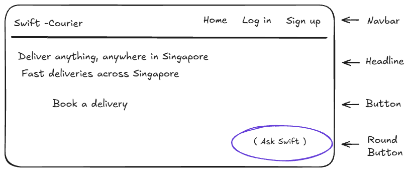
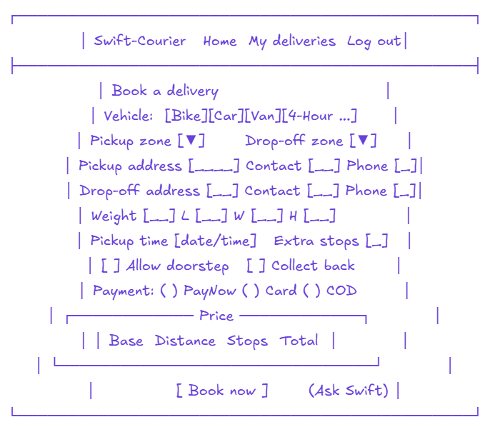
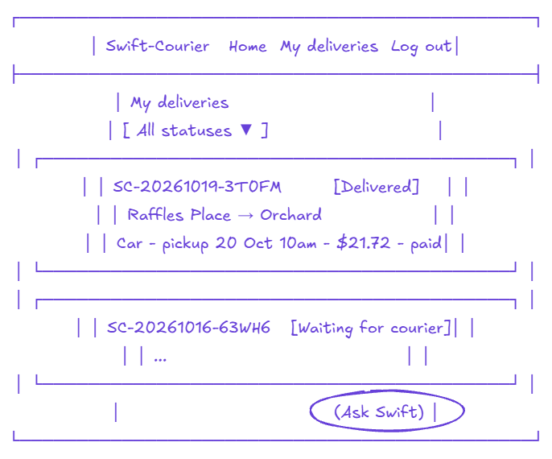
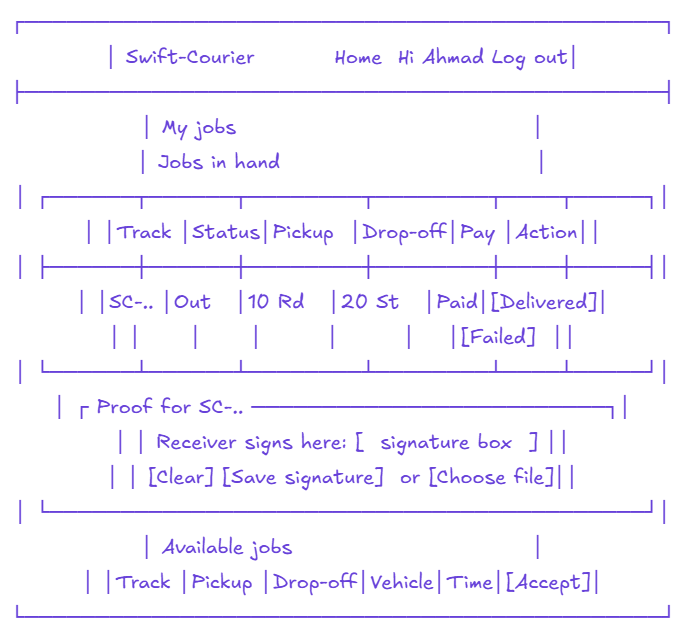
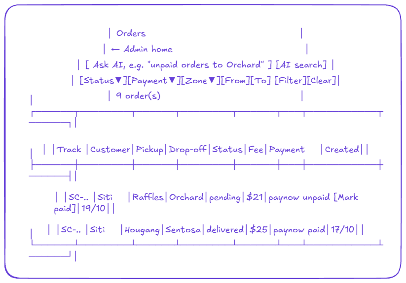
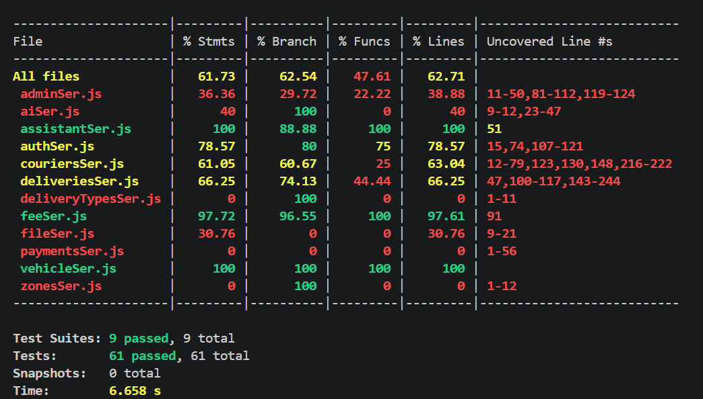

# Swift-Courier
A same-day courier booking platform for Singapore. Customers book and track deliveries, couriers pick up and deliver with photo or signature proof, and admins manage the warehouse, orders and users.

**Live app:** https://swift-courier-j18h.onrender.com
**Admin dashboard:** https://swift-courier-j18h.onrender.com/admin

> The free hosting sleeps when idle, so the first visit can take 30–60 seconds.

## 1. Project Summary

### Elevator pitch
Book a bike, car or van in under a minute, see the exact price before paying, and follow your parcel from pickup to doorstep. Ask Swift, an AI helper, answers questions about our services and your own parcels.

### Business context
Small businesses and individuals in Singapore need fast local deliveries, from documents to bulky boxes. Swift-Courier works by zones: couriers pick up in their own zones, parcels for other zones go through a central warehouse, and 4-Hour express jobs go straight to the receiver island-wide.

### Goals
- Customers: book in a few steps with a clear, fair price (distance, stops, outskirt/ERP surcharges).
- Couriers: see only the jobs they are allowed to take, update status, and record proof of delivery.
- Admin: hand warehouse parcels to couriers, find any order fast (filters + AI search), confirm payments.
- Business: fewer failed deliveries (doorstep option, 2 attempts, clear return fees).


## 2. UX/UI
### User stories and acceptance criteria

**Customer**
1. As a customer, I want to see the price before I book, so that there are no surprises.
   - Price updates when vehicle, zones, stops or pickup time change.
   - Breakdown shows base, distance, stops and surcharges.
2. As a customer, I want my parcel upgraded to a bigger vehicle if it doesn't fit, so that the booking doesn't fail.
   - Too heavy or too big → next vehicle is suggested and the price uses that vehicle.
3. As a customer, I want to filter my deliveries by status, so that I find a parcel quickly.
   - Picking a status shows only matching deliveries; "All statuses" shows all.
4. As a customer, I want to ask questions in plain English, so that I don't have to read long rules.
   - Ask Swift answers only from our rules and my own deliveries; unknown topics → "contact support".

**Courier**
5. As a courier, I want to see only the jobs I am allowed to take, so that I don't waste time.
   - Normal couriers see paid (or COD) pickups in their zones; express couriers see 4-Hour jobs.
6. As a courier, I want to record proof of delivery, so that the customer trusts it was delivered.
   - Doorstep allowed → photo only; otherwise the receiver signs on screen or a photo of signed paper.

**Admin**
7. As an admin, I want to hand warehouse parcels to couriers, so that every parcel gets delivered.
   - Only couriers covering the drop-off zone appear in the list.
8. As an admin, I want to find orders by status, payment, zone and date, or by typing a sentence, so that I answer customer calls fast.
   - "unpaid orders to Orchard" fills the filters automatically.
9. As an admin, I want to mark PayNow and card orders as paid, so that couriers can pick them up.
   - COD orders cannot be marked paid by admin (the courier collects the cash).

### Wireframes
| Page | Wireframe |
|------|-----------|
| Home |  |
| Book |  |
| My deliveries |  |
| Courier jobs |  |
| Admin orders |  |

### Five Planes of UX
- **Strategy:** fast, fair local deliveries; customers want price certainty, couriers want clear jobs, admin wants less manual work.
- **Scope:** booking with live price, tracking, courier job flow with proof, admin warehouse / orders / users, AI helper and AI search. (Out of scope: real payments (simulated), live GPS.)
- **Structure:** three roles with their own pages. One login for customers and couriers (redirect by role); a separate session login for admin.
- **Skeleton:** navbar at the top, forms and tables in the middle, Ask Swift floating at the bottom right; tables scroll sideways on small screens.
- **Surface:** Bootstrap for a clean, familiar look; coloured status badges (e.g. green Delivered, red Failed); orange Ask Swift button so it stands out.


## 3. Features
### Major features
- **Booking:** live price, auto vehicle upgrade, extra stops, doorstep / collect-back options, PayNow / card / COD (simulated payment).
- **Tracking:** My Deliveries with status filter, delivery detail with status history.
- **Courier:** available jobs, accept (first wins), status buttons, photo or signature proof, failed / returned flow.
- **Admin (EJS):** warehouse hand-out, orders with filters (status, payment, zone, date range) + mark paid, users list. Admins can only log in at `/admin/login`.
- **AI:** Ask Swift (RAG) for customers; plain-English order search for admin. If Gemini is busy, a lighter backup model answers.
- **UI:** home page with hero band and vehicle popup (Standard vs 4-Hour), mobile menu, footer; works at phone width.
- **Security:** JWT access + refresh tokens with logout blacklist, role checks, rate limiting, bcrypt passwords.

### Algorithms
- **Distance:** Haversine formula between zone centres (no paid maps API).
- **Price:** base + km × rate + stops × fee + zone surcharges (ERP only weekdays 7:30–9:30am, 5:30–8pm).
- **RAG search:** Gemini embeddings + cosine similarity, top 3 help texts.

### Known limitations
- Payment is simulated (no Stripe).
- Proof photos are not kept after a Render restart (no permanent disk on the free plan).
- Free hosting sleeps when idle; first load is slow.

### Pending
- Stripe test payments, CSRF protection, n8n agent, live GPS tracking(use simulated distance formula)


## 4. Use Cases

| Name | Objective | User steps |
|------|-----------|------------|
| Book a delivery | Customer sends a parcel | Log in → Book → fill zones, addresses, size → see price → choose payment → Book now → pay (PayNow/card) |
| Deliver a parcel | Courier completes a job | Log in → My jobs → Accept → Picked up → Out for delivery → Delivered → photo or signature |
| Hand out warehouse parcel | Admin sends parcel to drop-off courier | /admin → Warehouse → pick courier → Hand out |
| Find an order | Admin answers a customer call | /admin → Orders → type "unpaid orders to Orchard" → AI search (or use filters) |
| Ask a question | Customer gets help without calling | Click Ask Swift → type question → answer from our rules and own deliveries |


## 5. Technologies Used

- **Languages:** JavaScript, SQL, HTML, CSS
- **Frontend:** React 19, Vite, React Router, Jotai (login state), Axios, Bootstrap 5
- **Backend:** Node.js, Express 5, EJS (admin), express-session, JSON Web Tokens, bcrypt, express-rate-limit
- **Database:** MySQL 8.4 on Aiven (production), MariaDB (local development), mysql2
- **AI:** Google Gemini API via @google/genai (text, JSON output, embeddings)
- **Testing:** Jest (unit tests with mocks + coverage)
- **Tools:** Git, GitHub, VS Code, Excalidraw (wireframes), Render (hosting), Aiven (database)
- **Repo:** https://github.com/Ashraf-1981/swift-courier


## 6. Testing
### Automated unit tests (Jest)
56 tests in `backend/tests/` cover the business rules: courier status flow, admin filters, fees and ERP, booking rules, vehicle upgrade, auth, delivery proof and the RAG helper. Database and Gemini are mocked, so tests run offline in about 3 seconds.

```bash
cd backend
npm test            # run all tests
npm run coverage    # tests + coverage report
```



### Manual test cases
| # | Test | Steps | Expected | Result |
|---|------|-------|----------|--------|
| 1 | Login redirect by role | Log in as courier, then as customer | Courier → My jobs; customer → Home | Pass |
| 2 | Booking price | Book: change vehicle / stops / time | Price updates; ERP only at peak | Pass |
| 3 | Status filter | My Deliveries → pick "Delivered" | Only delivered cards show | Pass |
| 4 | Courier accept | My jobs → Accept | "Job accepted"; job moves to Jobs in hand | Pass |
| 5 | Signature proof | Out for delivery → Delivered → sign → Save | "Delivered"; image saved | Pass |
| 6 | Admin filters | Orders → Pending + Unpaid → Filter | Only matching rows; dropdowns stay selected | Pass |
| 7 | Admin AI search | Type "delivered parcels going to Orchard" | Filters set to Delivered + Orchard | Pass |
| 8 | Mark paid | Click Mark paid on unpaid PayNow | Green message; row shows paid | Pass |
| 9 | Ask Swift | Ask "Do you deliver to Malaysia?" | "Not sure, contact support" (no made-up answer) | Pass |
| 10 | Rate limit | 11 wrong logins in a row | 11th returns 429 "Too many login attempts" | Pass |
| 11 | Gemini down | Wi-Fi off, ask Ask Swift | Friendly error; reason in `logs/app.log` | Pass |
| 12 | Wrong role | Customer opens `/courier/jobs` | Sent back to Home | Pass |


## 7. Deployment
| Part | Where |
|------|-------|
| App (Express + React build + EJS admin) | Render, free web service, Singapore |
| Database | Aiven, free MySQL 8.4, SSL required |

One Express server serves the React build, the `/api` routes and the `/admin` pages, so everything uses one URL. Every push to `main` redeploys automatically.

### Environment variables
Set in Render (and in `backend/.env` locally, which is not committed):

| Key | Purpose |
|-----|---------|
| `DB_HOST`, `DB_PORT`, `DB_USER`, `DB_PASSWORD`, `DB_NAME` | Database connection |
| `DB_SSL` | `true` online (Aiven needs encryption) |
| `TOKEN_SECRET`, `REFRESH_TOKEN_SECRET` | Sign JWT access / refresh tokens |
| `SESSION_SECRET` | Sign the admin session cookie |
| `GEMINI_API_KEY`, `GEMINI_MODEL`, `GEMINI_FALLBACK_MODEL` | Gemini AI (main + backup model) |
| `DEMO_PASSWORD` | Password for the demo accounts (local seed only) |

`PORT` is set by Render automatically.

### Steps
1. **Database:** create a free MySQL service on Aiven. Export the local database (`mysqldump`) and import it with `backend/scripts/import-aiven.js` (local MariaDB → MySQL needed small fixes: MariaDB-only lines, foreign key names, collation).
2. **App:** on Render, create a Web Service from this GitHub repo:
   - Build: `cd frontend && npm install && npm run build && cd ../backend && npm install`
   - Start: `cd backend && node index.js`
3. Add the environment variables above, then deploy.
4. Check `/api/db-check` shows `"connected": true`.

```bash
cd backend && npm install && npm run dev      # http://localhost:3000
cd frontend && npm install && npm run dev     # http://localhost:5173
```
Run the SQL files in `backend/sql/` in order, then `node scripts/seed-knowledge.js` once for the AI help texts and `node scripts/seed-demo-users.js` for the demo accounts. Manual check scripts are in `backend/tests/manual/`.


## 8. Credits

- **Libraries:** React, Vite, React Router, Jotai, Axios, Bootstrap, Express, EJS, express-session, express-rate-limit, jsonwebtoken, bcrypt, mysql2, @google/genai, Jest, nodemon (all open source, see `package.json`).
- **AI:** Google Gemini API (answers, JSON filters, embeddings).
- **Formulas:** Haversine distance formula; cosine similarity for RAG.
- **Hosting:** Render (app), Aiven (MySQL).
- **Design:** Bootstrap 5 components; wireframes drawn in Excalidraw.
- **Learning:** course materials and lecturer guidance (JWT, RAG with embeddings, Gemini API).
